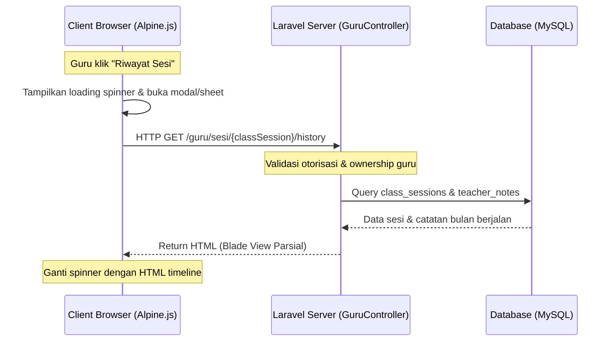

# Musik KITA — Spesifikasi Desain Riwayat Sesi Guru Portal
**Tanggal**: 19 Juni 2026
**Status**: Disetujui (Approved)
**Target**: Portal Guru (Portal Self-Service Pengajar)

---

## 1. Deskripsi Fitur (Feature Summary)
Saat menginput absensi dan catatan/laporan sesi hari ini, guru membutuhkan rujukan tentang materi apa yang diajarkan pada sesi-sesi sebelumnya di bulan berjalan agar pengajaran tetap konsisten dan terarah.

Fitur ini menyediakan tombol **Riwayat Sesi** pada form catatan sesi. Ketika ditekan, sistem akan menarik data sesi sebelumnya untuk murid/enrollment yang sama secara dinamis (via AJAX) dan menampilkannya dalam bentuk:
- **Bottom Sheet Drawer** (Geser naik dari bawah) pada perangkat mobile/tablet.
- **Centered Modal Dialog** (Popup mengambang di tengah) pada PC/desktop.

---

## 2. Arah Desain & Responsivitas (UI/UX)
Mengikuti identitas visual "Mahogany & Mint" milik Musik KITA (`DESIGN.md`):
- **Warna Utama**: Mahoni Gelap (`#4A1F0A`) sebagai header/elemen struktural, Mint Accent (`#5DB890`) untuk outline tombol dan penanda timeline.
- **Canvas/Backdrop**: Latar belakang abu-hijau mint lembut (`#F5F9F7`), dengan backdrop gelap transparan di luar area modal/sheet saat aktif.
- **Kerapian Spasi**: Menggunakan layout vertikal timeline yang lapang, jarak teks yang pas (line length < 75ch), serta tipografi *Hanken Grotesk* agar mudah dibaca di layar sentuh ukuran kecil tanpa terlihat padat/sempit.

### Alur Adaptasi Responsif:
- **Layar Mobile (< 640px)**: Bottom Sheet setinggi maksimal 85% layar dengan sudut melengkung di atas (*rounded-t-2xl*), lengkap dengan drag handle horizontal di bagian atas drawer.
- **Layar PC/Tablet (>= 640px)**: Centered Modal mengambang tepat di tengah layar dengan lebar tetap `max-w-lg` (`480px`) dan semua sudut melengkung (*rounded-2xl*).

---

## 3. Arsitektur Teknis & Alur Data (Technical Architecture)
Kami memilih **Pendekatan 1: AJAX Dynamic Loading** untuk efisiensi performa server dan kerapian struktur DOM.

### Alur Interaksi & Komunikasi:


---

## 4. Rencana Implementasi Kode

### A. Rute Baru (`routes/web.php`)
Menambahkan rute internal khusus guru untuk mengambil data riwayat sesi secara parsial:
```php
Route::get('/sesi/{classSession}/history', [GuruController::class, 'sessionHistory'])
    ->name('sesi.history');
```

### B. Controller (`app/Http/Controllers/GuruController.php`)
Menambahkan method `sessionHistory` dengan verifikasi otorisasi:
- Hanya boleh diakses oleh guru utama (`teacher_id`) atau guru pengganti (`substitute_teacher_id`) dari sesi tersebut.
- Melakukan query sesi-sesi lain di bulan/tahun berjalan untuk `enrollment_id` yang sama, diurutkan secara deskending (`session_date` terbaru di atas).
- Mengembalikan Blade view parsial.

```php
public function sessionHistory(ClassSession $classSession)
{
    $teacher = auth()->user()->teacher;
    abort_if(!$teacher, 403);
    
    // Validasi kepemilikan sesi
    abort_if(
        $classSession->teacher_id !== $teacher->id && 
        $classSession->substitute_teacher_id !== $teacher->id, 
        403, 
        'Bukan sesi Anda.'
    );

    // Ambil semua sesi untuk enrollment ini pada bulan berjalan (tidak termasuk sesi aktif ini)
    $history = ClassSession::where('enrollment_id', $classSession->enrollment_id)
        ->where('id', '!=', $classSession->id)
        ->where('attribution_month', $classSession->attribution_month)
        ->where('attribution_year', $classSession->attribution_year)
        ->whereIn('status', ['HADIR', 'HADIR_TERLAMBAT'])
        ->with('teacherNote')
        ->orderByDesc('session_date')
        ->orderByDesc('start_time')
        ->get();

    return view('guru._sesi-history-timeline', compact('history', 'classSession'));
}
```

### C. View Timeline Parsial (`resources/views/guru/_sesi-history-timeline.blade.php`)
Berisi kode timeline vertikal yang rapi dan bersih. Jika `$history` kosong, tampilkan *empty state* yang manis.
Tiap item menampilkan tanggal, rating bintang, materi yang dipelajari, tugas, serta catatan tambahan.

### D. Tombol Pemicu (`resources/views/guru/_sesi-absensi-actions.blade.php`)
Menambahkan tombol **Riwayat Sesi** dengan event dispatch Alpine.js ke global handler:
```html
<button type="button" 
        class="history-btn flex items-center gap-1 text-xs text-secondary border border-secondary/30 rounded-lg px-2.5 py-1 hover:bg-secondary/5 font-semibold transition"
        @click="$dispatch('open-session-history', { sessionId: {{ $sesi->id }}, studentName: '{{ $sesi->student->full_name }}' })">
    ⏳ Riwayat Sesi
</button>
```

### E. Global Bottom Sheet / Modal Layout (`resources/views/layouts/guru.blade.php`)
Di bagian bawah file layout utama, kita tambahkan satu wrapper Alpine.js untuk sheet/modal.
Wrapper ini mendengarkan event global `open-session-history`. Ketika terpancing, ia akan:
1. Menampilkan loading placeholder.
2. Melakukan `fetch(`/guru/sesi/${detail.sessionId}/history`)`.
3. Memasukkan respons HTML ke dalam body.
4. Memicu transisi CSS transisi slide-up (mobile) atau modal zoom-in (PC).

---

## 5. Rencana Pengujian (Testing Plan)
- **Otorisasi Sesi**: Pastikan Guru A tidak bisa mengakses riwayat sesi murid dari kelas Guru B melalui URL langsung.
- **Bulan Berjalan**: Pastikan sesi yang tampil hanya dari bulan/tahun atribusi yang sama.
- **Responsivitas**: Tes visual di browser developer tools pada ukuran layar mobile (<640px) untuk memastikan drawer bergeser dari bawah, dan pada layar PC untuk memastikan box mengambang di tengah.
- **Tanpa Catatan**: Skenario di mana sesi berstatus hadir tetapi guru tidak mengisi catatan (tetap tampil status kehadirannya saja secara elegan).
